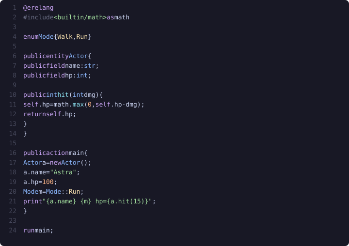
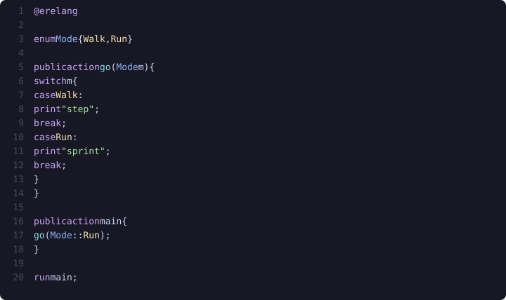
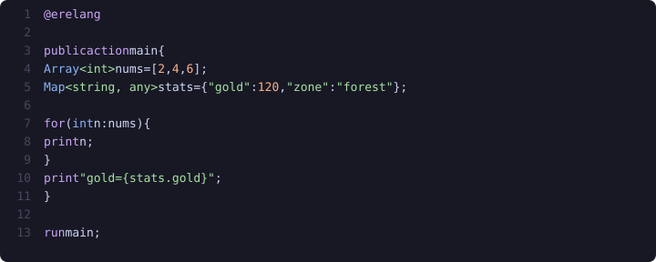
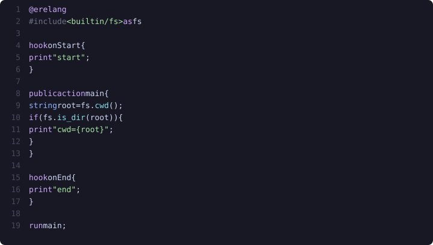
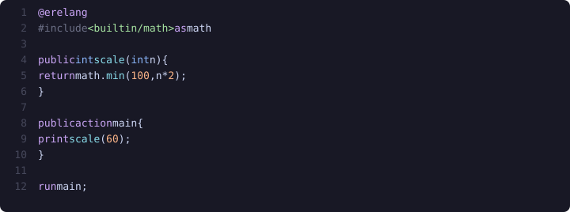

# Erelang

<p align="center">
  
  
  
  
  
  
</p>

Erelang is a scripting language with its own interpreter (`erelang`). You write `.elan` files: actions, entities, enums, hooks, then `run` an entry point. The runtime is C++20 and runs on Windows, Linux and macOS. The goal is to use it in real projects.

Python is the default for this kind of work. Use it if you need PyPI or a language other people already know. Erelang is for when that is the problem, not the solution: one executable, no venv, no pip, syntax and runtime in the same repo so you can change either.

A script only gets filesystem or HTTP if it `#include`s them. The typechecker fails the compile on bad types instead of waiting until line 400. Entities, hooks, and `run` are the program model. That is closer to a small game or tool than to a Python module.

If you wanted Lua-in-C++, you still do not own the language. Here you do.

Windows (MinGW):

```bash
cmake --preset debug
cmake --build --preset debug --target erelang_runner -j 8
./build/debug/bin/Debug/erelang.exe examples/program.elan
```

Linux and macOS (needs the libcurl and OpenSSL development packages):

```bash
cmake --preset unix-debug
cmake --build --preset unix-debug --target erelang_runner -j 8
./build/debug/bin/Debug/erelang examples/program.elan
```

`-DERELANG_EXPERIMENTAL=ON` enables `builtin/threads` and `builtin/monitor`.

## Entity



## Switch



## Collections



## Filesystem and hooks



## Include



Docs: [docs/](docs/README.md). Editor: `erevos-language/`. License: [Apache-2.0](LICENSE).
