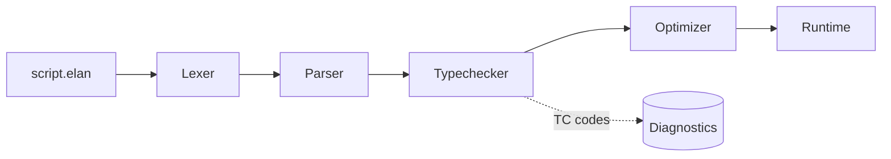

# Erelang

Erelang is a small, typed scripting language with a C++20 interpreter. These pages cover the
language, the standard modules, and the tools.

```elan
@erelang

public action main() {
    Array<int> scores {3} = [10, 20, 30];
    print "total: {scores.len()}";
}
run main;
```

<div class="grid cards" markdown>

- :material-rocket-launch: **[Getting started](guide/getting-started.md)**

    Build the interpreter and run your first script.

- :material-book-open-variant: **[Language](guide/language.md)**

    Actions, types, control flow and entities.

- :material-code-tags: **[Syntax reference](guide/syntax.md)**

    Every construct, operator and type in one place.

- :material-alert-circle-check: **[Diagnostics](guide/diagnostics.md)**

    What each typechecker `TC` code means and how to fix it.

- :material-toolbox: **[Toolchain](guide/toolchain.md)**

    `erelang`, `obc` and the CMake flags.

- :material-microsoft-visual-studio-code: **[VS Code extension](editor/vscode.md)**

    Highlighting, snippets and diagnostics from a `.vsix`.

</div>

## How a script runs



## Standard modules

<div class="grid cards" markdown>

- :material-folder-outline: **[Filesystem](modules/filesystem.md)**: `builtin/fs`, `builtin/path`
- :material-console: **[Process](modules/process.md)**: `exec`, `spawn`, `builtin/system`
- :material-lan: **[Network](modules/network.md)**: HTTP, TCP, UDP, WebSocket
- :material-format-list-bulleted: **[Collections](modules/collections.md)**: lists, dicts, `Array`, `Map`
- :material-format-text: **[Strings](modules/strings.md)**: `string.*`, interpolation
- :material-calculator-variant: **[Math](modules/math.md)**: `builtin/math`
- :material-database: **[Data](modules/data.md)**: `builtin/data`
- :material-lock: **[Crypto](modules/crypto.md)**: `builtin/crypto`
- :material-regex: **[Regex](modules/regex.md)**: `builtin/regex`
- :material-brain: **[AI](modules/ai.md)**: `builtin/ai`, patterns from samples or English
- :material-numeric: **[Binary](modules/binary.md)**: `builtin/binary`
- :material-shield-key: **[Permissions](modules/permissions.md)**: `builtin/perm`
- :material-function: **[Core builtins](modules/core-builtins.md)**: no import needed

</div>

!!! note "Experimental"
    `builtin/threads` ([Threads](modules/threads.md)) and `builtin/monitor`
    ([Monitor](modules/monitor.md)) need `-DERELANG_EXPERIMENTAL=ON`.

## Advanced

- [Memory](advanced/memory.md): native pointers and ownership
- [Low level](advanced/low-level.md): file handles, pointers, string buffers
- [Automation](advanced/automation.md): file, process and HTTP patterns
- [Builtins inventory](advanced/builtins-inventory.md): every builtin and its status

## Examples

- `examples/program.elan`: small run target (includes the debugger lib)
- `examples/language_kitchen_sink.elan`: language surface
- `examples/modules/math.elan`: included actions

## Reading these docs

```bash
cd docs
run          # Windows: run.cmd.   Other systems: ./run.sh
```

The first run installs MkDocs Material and its plugins from `requirements.txt`, then serves the
site at <http://127.0.0.1:8000>. Use `run build` to write a static copy to `docs/site`.
